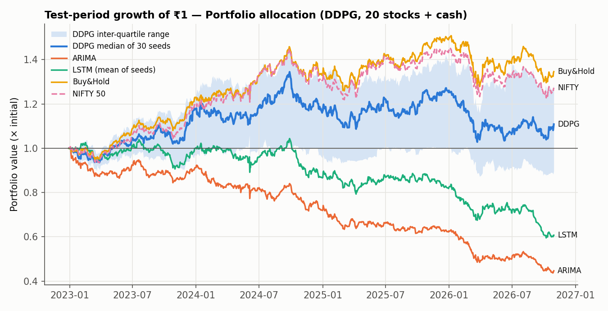
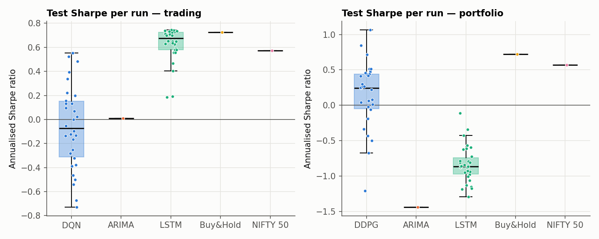

# Deep RL to Optimise Stock Trading Strategy — NIFTY50

**FinSearch · Finance Club, IIT Bombay · End-term project**

A deep reinforcement learning framework for algorithmic stock trading and
portfolio optimisation on NIFTY50 stocks. It extends our mid-term DQN/CartPole
pipeline to real market data:

| | Task | Agent | Action space |
|---|---|---|---|
| 1 | **Single-stock trading**: one policy trades each of 20 NIFTY50 stocks | **DQN** (Double + Dueling) | discrete target exposure {0, ½, 1} |
| 2 | **Portfolio optimisation**: one pot of capital across 20 stocks + cash | **DDPG** | continuous weights on the simplex |

Both agents are benchmarked against **ARIMA** and **LSTM** forecasting strategies,
plus Buy & Hold and the NIFTY 50 index. All of them trade in the **same
environments, with the same costs and timing**, over **30 seeds**, on a test
period the models never see during training or tuning.

<!-- RESULTS:START -->
## Results (held-out test, Jan 2023 → Oct 2026)

30 seeds per learned method, 0.1% cost on every trade for every method.
Full tables: [`results/final/summary.md`](results/final/summary.md).

**Portfolio task: DDPG vs baselines**

| Method | Runs | Sharpe (mean ± std) | Ann. return | Max DD |
|---|---:|---:|---:|---:|
| **DDPG** | 30 | **+0.15 ± 0.47** | **+1.9% ± 8.5%** | 30.6% |
| ARIMA (top-5) | 1 | −1.44 | −19.4% | 56.4% |
| LSTM (top-5) | 30 | −0.84 ± 0.26 | −12.7% ± 3.4% | 45.1% |
| Buy & Hold (equal-weight) | 1 | +0.73 | +8.3% | 15.2% |
| NIFTY 50 index | 1 | +0.57 | +6.7% | 15.8% |

DDPG beats both forecasting baselines on Sharpe in **30/30 (ARIMA)** and
**29/30 (LSTM)** seeds. The forecast strategies rebalance into their top-5
picks every day and lose heavily to costs. DDPG does **not** beat passive
Buy & Hold or the index, and it varies a lot from seed to seed.

**Trading task: DQN vs baselines**

| Method | Runs | Sharpe (mean ± std) | Ann. return | Max DD |
|---|---:|---:|---:|---:|
| **DQN** | 30 | **−0.06 ± 0.35** | **−0.4% ± 2.4%** | 16.1% |
| ARIMA (long/flat) | 1 | +0.01 | −0.4% | 20.6% |
| LSTM (long/flat) | 30 | +0.63 ± 0.15 | +6.7% ± 1.9% | 15.4% |
| Buy & Hold | 1 | +0.73 | +8.3% | 15.2% |

DQN roughly ties ARIMA but falls well short of the LSTM and Buy & Hold. Its
validation Sharpe (+0.70) did not carry over to the test period, which points
to overfitting to the 2021–22 market regime.




Tuning: 16 configurations × 3 seeds per agent, ranked by validation Sharpe
([`results/figures/hyperparameter_sweep.png`](results/figures/hyperparameter_sweep.png)).
Selected: DQN uses a log-return reward, 20-day window and 5 exposure levels;
DDPG uses the risk-adjusted (mean-variance) reward with λ = 0.1, a 3-day
window and γ = 0.99.
<!-- RESULTS:END -->

---

## Quick start

```bash
git clone https://github.com/rujulaaaa/Deep-Reinforcement-Learning-for-Stock-Trading-and-Portfolio-Optimization.git
cd Deep-Reinforcement-Learning-for-Stock-Trading-and-Portfolio-Optimization
python3 -m venv .venv
.venv/bin/pip install torch --index-url https://download.pytorch.org/whl/cpu
.venv/bin/pip install -r requirements.txt
.venv/bin/pip install -e .

.venv/bin/python -m pytest              # 14 unit tests (accounting, leakage, agents)
./run_all.sh --quick                    # whole pipeline with tiny budgets (~3 min) → results/quick/
./run_all.sh                            # full experiment (~1–1.5 h on 12 CPU cores)
```

### Demo (≈2–3 min, after `./run_all.sh`)

```bash
./demo.sh                 # unit tests → data → live mini-training → DQN & DDPG replays → results → figures
./demo.sh --no-train      # skip the ~40 s live training section
./demo.sh --fast --stock TCS.NS
```

Run the stages individually:

```bash
python scripts/download_data.py                  # Yahoo Finance → data/raw/ (cached)
python scripts/train.py --algo dqn --seed 0      # one agent, verbose training log
python scripts/tune.py --algo ddpg               # 16-config random search on VALIDATION
python scripts/evaluate.py --algo dqn ddpg       # 30 seeds with the tuned config → TEST
python scripts/run_baselines.py                  # ARIMA, LSTM (30 seeds), Buy&Hold, index
python scripts/report.py                         # tables + figures
```

Any hyper-parameter can be overridden without editing files:
`--set env.reward=dsr dqn.lr=1e-4 env.cost=0.002`. Add `--workers N` to change
parallelism.

## Project structure

```
Deep-Reinforcement-Learning-for-Stock-Trading-and-Portfolio-Optimization/
├── configs/
│   ├── default.yaml          # every hyper-parameter, commented
│   └── sweep.yaml            # search spaces for tuning (incl. reward shaping)
├── finsearch/                # the library
│   ├── data.py               # download, cleaning, 11 technical features, split, normalisation
│   ├── envs/
│   │   ├── base.py           # shared accounting (costs, drift, timing) for every strategy
│   │   ├── trading_env.py    # single-stock env, discrete actions   (DQN)
│   │   ├── portfolio_env.py  # 20-stock + cash env, continuous actions (DDPG)
│   │   └── rewards.py        # reward shaping: log-return, mean-variance, drawdown, DSR
│   ├── agents/
│   │   ├── networks.py       # Q-network (dueling), actor (softmax), critic
│   │   ├── replay_buffer.py
│   │   ├── dqn.py            # Double/Dueling DQN
│   │   └── ddpg.py           # DDPG with logit-space Gaussian exploration
│   ├── baselines/
│   │   ├── forecast.py       # ARIMA + LSTM forecasters → positions → backtest
│   │   └── passive.py        # Buy & Hold, NIFTY 50 index
│   ├── runner.py             # train loop, val-based checkpoint selection, evaluation
│   └── metrics.py            # Sharpe, Sortino, max drawdown, Calmar, …
├── scripts/                  # CLI entry points (see Quick start)
├── tests/test_core.py        # accounting, no-look-ahead, reward and agent tests
├── results/                  # generated: tuning/, final/, figures/
└── run_all.sh
```

## Methodology

### Data
* **Universe**: 20 NIFTY50 constituents listed continuously since 2010
  (RELIANCE, TCS, HDFCBANK, INFY, ICICIBANK, HINDUNILVR, ITC, SBIN, BHARTIARTL,
  KOTAKBANK, LT, AXISBANK, ASIANPAINT, MARUTI, SUNPHARMA, TITAN, ULTRACEMCO,
  BAJFINANCE, NESTLEIND, WIPRO) plus the `^NSEI` index, from Yahoo Finance
  (split/dividend-adjusted daily OHLCV).
* **Size**: 4,073 trading days × 20 stocks = **81,460 stock-days**
  (≈ 407k OHLCV values) after a 60-day indicator warm-up.
* **Features (11 per stock-day)**: 1/5/20-day log returns, 20-day volatility,
  RSI-14, MACD histogram, Bollinger %B, gaps to SMA-20/50, ATR-14, volume z-score.
  All are causal (row *t* uses data ≤ *t*; tested in `tests/`), z-scored with
  **train-only** statistics and clipped to ±5.
* **Chronological split**

  | Split | Period | Days | Used for |
  |---|---|---:|---|
  | train | 2010-04 → 2020-12 | 2,633 | fitting agents, ARIMA, LSTM |
  | val | 2021-01 → 2022-12 | 496 | checkpoint selection, hyper-parameter tuning, LSTM early stopping |
  | test | 2023-01 → 2026-10 | 944 | final numbers only, touched once |

### Environments (MDP formulation)
* **Timing**: at the close of day *t* the agent sees features up to *t*, picks
  target weights, pays `0.1% × turnover`, and earns the close-to-close return of
  day *t+1*. Every strategy, RL or baseline, goes through the same
  `rebalance_step` accounting.
* **Trading env (DQN)**: state = last 10 days × 11 features of one stock +
  current exposure (111-dim); action = target exposure. Training episodes sample
  a random stock and a random 1-year segment, so one policy learns from all 20
  stocks. At test time it trades each stock independently with equal capital.
* **Portfolio env (DDPG)**: state = last 5 days × 20 stocks × 11 features +
  current weights (1,121-dim); action = long-only weights over cash + 20 stocks.

### Reward shaping (`finsearch/envs/rewards.py`)
| `env.reward` | Per-step reward |
|---|---|
| `log_return` | s · r<sub>t</sub> (net of costs) |
| `risk_adjusted` | s · r<sub>t</sub> − λ (s · r<sub>t</sub>)² — mean-variance utility |
| `drawdown` | s · r<sub>t</sub> − λ<sub>dd</sub> · s · max(0, ΔDD<sub>t</sub>) — penalise new drawdown |
| `dsr` | Differential Sharpe Ratio (Moody & Saffell, 2001) |

The reward type and its λ are searched together with the agent hyper-parameters.

### Agents
* **DQN**: Double DQN targets, dueling head, Huber loss, Adam, gradient
  clipping, hard target updates, linear ε-decay. Episode ends are treated as
  time-limit truncations (we keep bootstrapping, as in the mid-term).
* **DDPG**: softmax actor (weights valid by construction), LayerNorm MLPs,
  Gaussian exploration on the pre-softmax logits with decaying σ, Polyak target
  updates.
* **Model selection**: every 5k steps the policy is evaluated on the validation
  split, and the best-Sharpe checkpoint is kept. Test data plays no part in it.

### Hyper-parameter tuning
`scripts/tune.py` draws **16 configurations per agent** (reproducible random
search over `configs/sweep.yaml`; config 0 = defaults), trains each with 3
seeds, and ranks them by mean **validation** Sharpe. The winner is written to
`results/tuning/best_<algo>.yaml` and used for the final 30-seed evaluation.

### Baselines
* **ARIMA**: per-stock ARMA(p, q) on daily returns. The order is chosen by AIC
  over 6 candidates and the parameters are fitted on train only. A Kalman filter
  with frozen parameters then produces genuine one-step-ahead forecasts on
  val/test.
* **LSTM**: one pooled LSTM (64 units) maps the same 10-day feature window to
  next-day return; early-stopped on validation MSE; 30 seeds.
* **Forecast → positions**: trading task: long if forecast > 0, else flat.
  Portfolio task: equal-weight the top-5 positive forecasts, the rest in cash.
* **Buy & Hold** (equal-weight, no rebalancing) and the **NIFTY 50 index**
  (no costs) are passive references.

### Metrics
Annualised Sharpe (rf = 0, 252 days), annualised and cumulative return, max
drawdown, Sortino, Calmar, and daily turnover. `report.py` gives mean ± std over
seeds, the relative change of the RL mean vs each baseline, and the share of
seeds that beat each baseline.

## Limitations
* **Survivorship bias**: the universe is today's large caps that existed in
  2010. This flatters every long-only method, Buy & Hold included, so compare
  methods with each other, not with absolute returns.
* Close-to-close execution with a flat 0.1% cost; no slippage model, market
  impact, or short selling.
* One test regime (2023–2026). Walk-forward retraining would give a more
  robust estimate.
* RL results are noisy across seeds. Always quote the mean ± std over the 30
  runs, not the best seed.

## Team
Rujula, Manvi, Kasak · FinSearch, Finance Club IIT Bombay
# Deep-Reinforcement-Learning-for-Stock-Trading-and-Portfolio-Optimization
# Deep-Reinforcement-Learning-for-Stock-Trading-and-Portfolio-Optimization
# Deep-Reinforcement-Learning-for-Stock-Trading-and-Portfolio-Optimization
